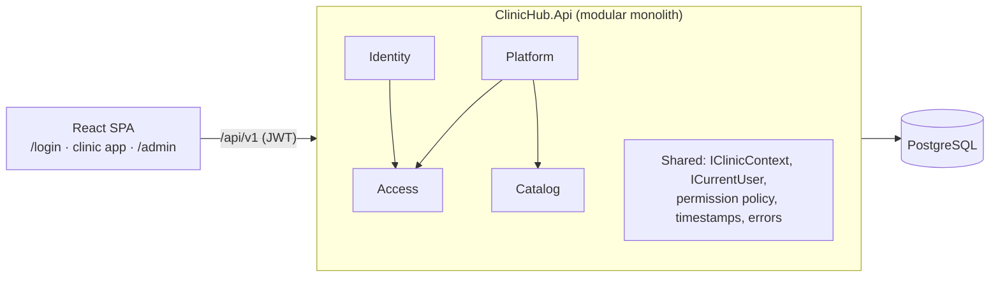
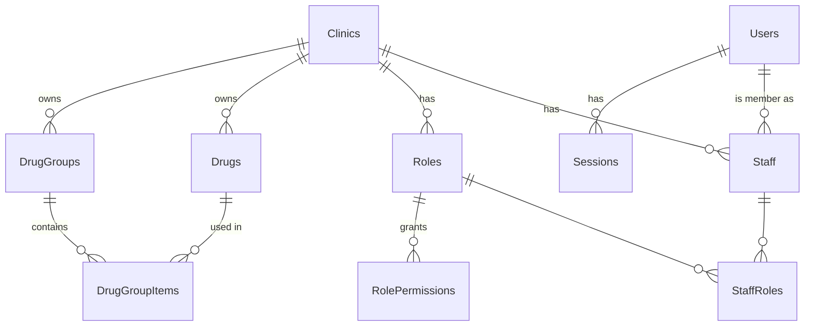
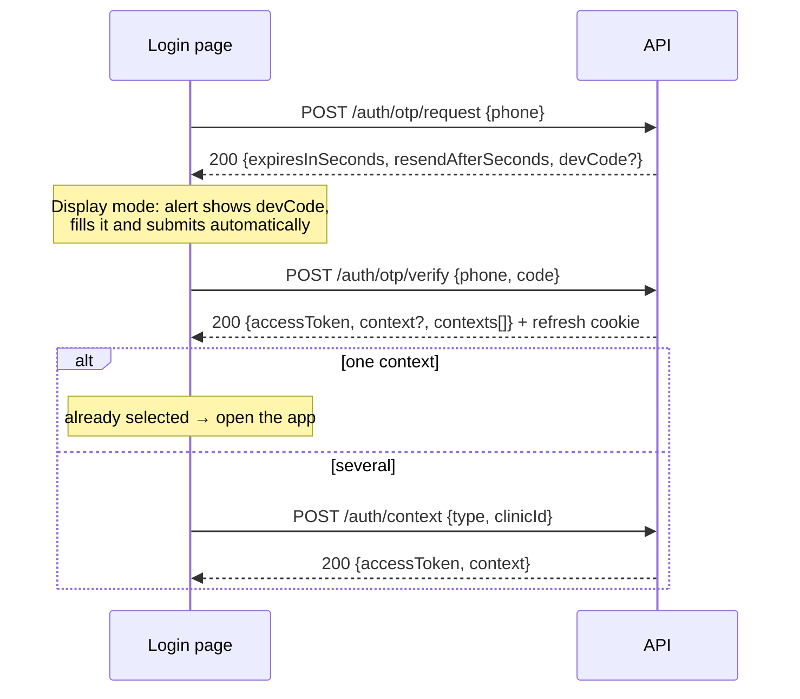

# High-level design: multi-clinic platform (MVP)

Status: **agreed design; the MVP (Phase 1) is in progress**: M1.1 clinic isolation, M1.2 login, M1.3 access and
M1.4 architecture refactor are done ([clinic scoping](../features/clinic-scoping/tech.md),
[login](../features/auth/tech.md), [access](../features/access/tech.md), [architecture](architecture.md));
M1.5 platform admin is built ([design](m1.5-platform-admin.md); the admin API for clinics, provisioning, roles and
staff, the admin area and its clinic, role and staff screens: [platform admin](../features/platform-admin/tech.md));
M1.6 test foundation is built ([design](m1.6-test-foundation.md), [testing README](../testing/README.md)); M1.7 shared
drug catalog is in progress ([design](m1.7-shared-catalog.md): M1.7a protocols rename, M1.7b catalog core + admin
([shared catalog](../features/shared-catalog/tech.md)), M1.7c catalog clinic screens): from now on
every step adds its test cases and tests with its feature. See [Delivery](#12-delivery-phase-1-mvp).
Decided in discussion on 2026-10-11.
When each step is built it gets its own `docs/features/<feature>/` (tech + business), its cases in the
[test catalog](../testing/test-catalog.md) and their tests, and the overviews are updated; this file stays the big picture.

The MVP covers the clinic platform, **patients** (with dynamic forms) and the **patient portal**. It is
the base of the full product, **not a throwaway**: later features (audit, support access, owners
managing their own staff…) are additions, not rewrites. See [Designed ahead](#11-designed-ahead).

**Delivery terms:** a **phase** is a product stage (Phase 1 = the MVP, up to its first launch); a
**milestone** (M1, M2…) is a demoable part of a phase; a **step** (M1.5…) is one unit of work, built in
one implementation session and validated before the next. Older commits say "phase 1–5"; they map to
M1.1–M1.3 (phases 1–3), M1.4 (phase 3.5), M1.5 (phase 4) and M3.2 (phase 5).

---

## 1. Requirements

### 1.1 Functional (MVP)

| ID | Requirement |
|---|---|
| FR-1 | The platform hosts **many clinics**. Each clinic has its own drugs, groups, staff and roles; a clinic never sees another clinic's data. |
| FR-2 | **Login is phone number + one-time code (OTP)** for everyone. No passwords. |
| FR-3 | Until M3.2 the OTP is **displayed** (alert on the login page, code auto-filled and submitted; also printed to the server log). Sending by SMS/WhatsApp comes later as a config switch. |
| FR-4 | A user (phone) can be staff in **one or more clinics**. With several, they pick a clinic after login and can switch later. One clinic → entered automatically. |
| FR-5 | **Roles belong to one clinic** (no global roles). A staff member can have **several roles**; their permissions are the union. |
| FR-6 | **Permissions** are fixed in code, one per action (`drugs.create`, `drugs.delete`, …). Roles are sets of permissions. Every API action checks a permission. |
| FR-7 | Each clinic has a locked **Owner** role with every permission (cannot be edited or deleted; a clinic always keeps at least one Owner). |
| FR-8 | A **super admin** (platform level, above all clinics), identified by phone numbers in config, logs in with the same OTP flow. |
| FR-9 | The super admin **creates clinics** (name + owner phone and name), renames, suspends, re-activates and **deletes** them. A suspended clinic cannot be used. A deleted clinic is a soft delete (M1.5 D4): hidden everywhere, nobody can enter it, its data is kept; final in the MVP (no restore). |
| FR-10 | The super admin manages **any clinic's roles** (create, rename, set permissions, delete) and **staff** (add by phone, name, roles, deactivate, remove). |
| FR-11 | A new clinic is **provisioned** in one step: default roles, the owner, and a copy of the default drugs and groups. |
| FR-12 | Default drugs and groups live in a hidden **template clinic** that the super admin edits with the normal drugs/groups screens. Later template edits don't change existing clinics. |
| FR-13 | Drugs, groups and the prescription builder work as today, **inside the selected clinic**, gated by permissions. |
| FR-14 | The UI stays English + Arabic (RTL), including login and admin screens. |
| FR-15 | **Dynamic forms** (M2.1): a generic module to build, version and fill forms (RJSF; [POC](#11-designed-ahead)), usable by any feature. Its first user is patient info, but it must not depend on patients. Designed when M2.1 starts. |
| FR-16 | **Patients** (M2.2): staff register a patient by phone in their clinic; the patient's info is a dynamic form. One person (phone) can be a patient of several clinics, each with its own record. |
| FR-17 | **Patient portal** (M2.3): a patient logs in with the same phone + OTP and sees the clinics they belong to. |

### 1.2 Non-functional

| ID | Requirement |
|---|---|
| NFR-1 | **Isolation by default:** clinic scoping is automatic (EF query filter), not something each endpoint remembers. |
| NFR-2 | Permission or role changes apply within a minute, without logging in again. |
| NFR-3 | OTP brute force is limited (attempts per code, codes per phone per hour, requests per IP). |
| NFR-4 | Display OTP mode is **opt-in by config** (startup warning outside Development); hard-blocked again in Production once an SMS sender exists. |
| NFR-5 | All times stored in UTC (`timestamptz`). Every table has `CreatedAt`/`UpdatedAt` (built: except the join tables `RolePermissions` and `StaffRoles`). |
| NFR-6 | One deployable (API + SPA), one PostgreSQL database. Production requires HTTPS. |
| NFR-7 | **Automated tests** (since M1.6; up to M1.5 every step was verified by hand). Every documented behavior is a case of the [test catalog](../testing/test-catalog.md) (P0/P1/P2, level `unit`/`api`/`ui`/`e2e`/`manual`), proved by xUnit unit and integration tests (the real app on PostgreSQL), Vitest unit and component tests and Playwright end-to-end journeys (Chromium only: desktop Arabic and English, a phone), run locally by `test.ps1` in three tiers (`step` after each round, `full` at a feature's end and before merging to `main`, `release` at a milestone's end; no CI). Gates: 100% of the P0 and P1 cases have a test (P2 reported, not gated); backend coverage ≥ 90% lines / 85% branches (95% branches in the critical modules); frontend pure logic ≥ 95% lines / 90% branches and 85% mutation; Stryker.NET ≥ 85% on each of the 6 critical backend files. Trimmed by the user (2026-10-15): e2e for P0 and P1 cases only, Chromium only, backend mutation on those 6 files only, P2 not gated. Each step adds its cases and tests with its feature ([testing README](../testing/README.md), [design](m1.6-test-foundation.md)). |
| NFR-8 | The SMS/WhatsApp OTP sender, rate limits per IP and the Display-mode block in Production land in M3.2, before launch. |

### 1.3 Out of the MVP (designed for, not built)

Audit log, super admin entering a normal clinic ("support access"), clinic self sign-up, owners
managing their own staff/roles (the M1.5 screens are built reusable for it), per-clinic feature
entitlements/plans, changing a user's phone, restoring a deleted clinic, clinic chains (organizations).
(Deleting a clinic moved **into** the MVP with M1.5: a soft delete, FR-9.)

---

## 2. Glossary

| Term | Meaning |
|---|---|
| **Clinic** | The unit of data ownership. Code uses "clinic" everywhere (never "tenant"). |
| **Template clinic** | A hidden clinic (`IsTemplate`) holding the default drugs/groups copied to new clinics. |
| **User** | A phone number that can log in. Holds no personal data; names live on `Staff`. |
| **Staff** | A user's membership in one clinic (name, active flag, roles). |
| **Role / Permission** | A clinic's named set of permissions / a code constant like `drugs.create`. |
| **Super admin** | A user whose phone is listed in config; acts on the platform, not inside a clinic. |
| **Context** | What a session is currently acting as: a clinic (as staff) or the platform (as super admin). |
| **Session** | A login on one device: a refresh token + the current context. |

---

## 3. Architecture

**Modular monolith:** one ASP.NET Core API, one PostgreSQL database, one React SPA, served from one
origin in production. Modules are folders with a clear owner of each table; a module uses another
module through its services, never by writing its tables.



| Module | Owns tables | Responsibility |
|---|---|---|
| **Identity** | `Users`, `OtpCodes`, `Sessions` | OTP, sessions, tokens, contexts, `/me`, super-admin flag |
| **Access** | `Staff`, `Roles`, `RolePermissions`, `StaffRoles` | Memberships, roles, permission catalog and checks |
| **Platform** | `Clinics` | Clinic lifecycle, provisioning, template clinic, admin endpoints |
| **Catalog** | `Drugs`, `DrugGroups`, `DrugGroupItems` | Existing drugs and groups, now clinic-scoped |
| **Prescription** | none (browser) | Existing builder, unchanged except storage per clinic |

### 3.1 Backend layout

*(M1.4 replaced this layout with four projects and per-module use cases: see
[backend architecture](architecture.md) and `docs/tech/overview.md`. Kept as the original plan.)*

```
ClinicHub.Api/
  Features/
    Identity/      AuthController, MeController, OtpService, SessionService, TokenService, PhoneNormalizer
    Access/        MembershipService (built in M1.2), PermissionService, Permissions.cs, DefaultRoles.cs, HasPermissionAttribute + handler
    Platform/      Admin*Controllers, ClinicProvisioningService, Seeders/ (IClinicSeeder implementations)
    Drugs/, DrugGroups/   (existing; become the Catalog module)
  Shared/          IClinicContext, ICurrentUser, IClinicOwned, IHasTimestamps, ErrorCodes, PagedResult
  Database/        AppDbContext (query filters, timestamps interceptor)
```

The current `Features/<Feature>` convention stays; a module may span several feature folders.
(Superseded from M1.4 by the layered projects in [backend architecture](architecture.md).)

---

## 4. Cross-cutting design

### 4.1 Clinic scoping

- `IClinicOwned { int ClinicId }` on every clinic-owned entity (`Drugs`, `DrugGroups`,
  `DrugGroupItems`, `Staff`, `Roles`).
- `IClinicContext { int? ClinicId }`, scoped per request, filled by middleware from the token's
  `clinic_id` claim. Admin endpoints set it from the `{clinicId}` route value instead. *(Built in M1.5.3: the
  admin clinic filter, `[AdminClinic]` on the roles and staff controllers, calls `IClinicScope.EnterAsync`; design D2.)*
- `AppDbContext` applies `e.ClinicId == clinicContext.ClinicId` to every `IClinicOwned` type.
  No clinic in context → the filter matches nothing (fail closed).
- On insert, `ClinicId` is filled from the context automatically (interceptor). Saving a
  clinic-owned row with no clinic in context throws.
- Only Platform code (provisioning, admin lists across clinics) may call `IgnoreQueryFilters()`.
- Use `FirstOrDefaultAsync` with a `Where`, not `FindAsync`, so lookups always go through the filter.
- Clinic routes **never** take a `clinicId`; the clinic comes only from the token.
- Side effect we rely on: a group can only reference drugs of its own clinic, because another
  clinic's drug is invisible and returns `drugNotFound`.

### 4.2 Current user and permissions

- `ICurrentUser { UserId, SessionId, ClinicId?, StaffId?, IsPlatform, IsSuperAdmin }` from claims.
- `[HasPermission(Permissions.DrugsUpdate)]` on actions → policy handler asks
  `PermissionService.GetPermissions(staffId)`.
- Permissions are **not** in the token. `PermissionService` loads the staff's roles + clinic status
  and caches it in memory for 60 s; any change to that clinic's roles/staff clears the cache. *(Built in M1.3 with HybridCache: 10 min expiry, 30 s local, invalidated by tag; see [access](../features/access/tech.md).)*
- Owner role → all permissions. Inactive staff or suspended clinic → 403 (`noAccess` /
  `clinicSuspended`).
- Admin endpoints: `[Authorize(Policy = "SuperAdmin")]` requires a platform-context token. *(Built in M1.5.1 as
  `AuthPolicies.PlatformAdmin`: a platform-context token whose user is **still** a super admin per the access
  cache (`IAccessCache.GetUserAsync`), else 403 `forbidden`; [design D1](m1.5-platform-admin.md#d1-admin-authorization-a-platformadmin-policy-not-permissions).)*

### 4.3 Timestamps

`IHasTimestamps { CreatedAt, UpdatedAt }` filled by a `SaveChanges` interceptor with
`DateTime.UtcNow`. `CreatedBy`/audit trail is deferred (Audit module later).

### 4.4 Errors

Unchanged convention: `ProblemDetails` with a `code`, translated by the SPA (`errors.<code>`).
401 = no/expired access token (the SPA refreshes and retries once). 403 = authenticated but not
allowed (`forbidden`, `noAccess`, `clinicSuspended`).

### 4.5 Phone numbers

Normalized to E.164 (`+201001234567`) with `libphonenumber-csharp`, default region `EG`.
Invalid → `invalidPhone`. The SPA sends what the user typed; the server normalizes.

---

## 5. Data model (PostgreSQL)

All `Id`s are `integer` identity unless noted. All tables except the join tables `RolePermissions` and `StaffRoles`
have `CreatedAt`/`UpdatedAt timestamptz NOT NULL` (omitted below). Names in PascalCase as EF creates them.



### 5.1 Identity

**Users**

| Column | Type | Rules |
|---|---|---|
| Id | int | PK |
| Phone | varchar(20) | E.164, **unique** |
| IsSuperAdmin | boolean | set only by the startup seeder from config |
| LastLoginAt | timestamptz null | |

**OtpCodes**

| Column | Type | Rules |
|---|---|---|
| Id | int | PK |
| Phone | varchar(20) | indexed `(Phone, CreatedAt)` |
| CodeHash | varchar(100) | HMAC-SHA256 of the code, never the code |
| ExpiresAt | timestamptz | now + 5 min |
| Attempts | int | max 5, then the code is dead |
| ConsumedAt | timestamptz null | single use |

Codes exist for any valid phone (even unknown ones) so responses don't reveal who has an account.
Old rows are deleted by a cleanup on each request (older than 1 day).

**Sessions**

| Column | Type | Rules |
|---|---|---|
| Id | uuid | PK, `sid` claim |
| UserId | int | FK → Users, cascade |
| RefreshTokenHash | varchar(100) | **unique**; rotated on every refresh |
| ContextType | varchar(20) null | `clinic` / `platform` / null (not chosen yet) |
| ClinicId | int null | FK → Clinics; set when `ContextType = clinic` |
| ExpiresAt | timestamptz | sliding: 30 days (12 h for every super-admin session, as built in M1.2) |
| LastUsedAt | timestamptz | |
| RevokedAt | timestamptz null | logout, staff removed, clinic suspended |

### 5.2 Access

**Staff** (`IClinicOwned`)

| Column | Type | Rules |
|---|---|---|
| Id | int | PK |
| ClinicId | int | FK → Clinics, restrict |
| UserId | int | FK → Users, restrict |
| FullName | varchar(256) | required |
| IsActive | boolean | inactive = cannot enter the clinic |
| | | **unique `(ClinicId, UserId)`** |

**Roles** (`IClinicOwned`)

| Column | Type | Rules |
|---|---|---|
| Id | int | PK |
| ClinicId | int | FK → Clinics, restrict |
| Name | varchar(100) | required, **unique `(ClinicId, Name)`** |
| IsOwner | boolean | locked, all permissions; **one per clinic** (partial unique index `(ClinicId) WHERE IsOwner`) |

**RolePermissions**: `RoleId` (FK, cascade) + `Permission varchar(100)`, PK `(RoleId, Permission)`.
Values must be in `Permissions.All` (`unknownPermission`). Owner roles have no rows (implicit all).

**StaffRoles**: `StaffId` (FK, cascade) + `RoleId` (FK, cascade), PK `(StaffId, RoleId)`.
The role must belong to the staff's clinic (checked in `AccessService`; the filter hides other clinics' roles anyway). *(Built in M1.3: `StaffRoles` also has `ClinicId`, with composite FKs to `Staff(Id, ClinicId)` and `Roles(Id, ClinicId)`, so the database enforces it.)*

### 5.3 Platform

**Clinics**

| Column | Type | Rules |
|---|---|---|
| Id | int | PK |
| Name | varchar(256) | required |
| Status | varchar(20) | `active` / `suspended` |
| IsTemplate | boolean | **one template** (partial unique index `WHERE IsTemplate`); excluded from admin lists and staff contexts |
| DeletedAt | timestamptz null | *(M1.5.1, migration `AddClinicDeletedAt`)* set = soft deleted; `Status` is not touched by a delete. No EF query filter: the few places that decide whether a clinic can be used check it explicitly ([design D4](m1.5-platform-admin.md#d4-clinic-soft-delete--a-deletedat-column-users-decision)) |

### 5.4 Catalog (changes to existing tables)

| Table | Change |
|---|---|
| Drugs | + `ClinicId` (FK, restrict), index `(ClinicId, Name)`, timestamps |
| DrugGroups | + `ClinicId` (FK, restrict), index `(ClinicId, Name)`, timestamps |
| DrugGroupItems | + `ClinicId` (same as its group; makes the filter uniform), timestamps; composite FKs `(DrugGroupId, ClinicId)` → `DrugGroups(Id, ClinicId)` and `(DrugId, ClinicId)` → `Drugs(Id, ClinicId)` so the DB enforces one clinic per line |

Everything else (owned `Dosing`, cascades, one drug per group per eye) is unchanged.

### 5.5 Migrations

Nothing is in production, so the PostgreSQL `Initial` is regenerated with this schema and dev
databases are reset (`docker compose down -v`). After the first deployment, the data-preserving
rules in the tech overview apply.

---

## 6. Permissions and default roles

`Features/Access/Permissions.cs` (labels in `en.ts`/`ar.ts` under `permissions.*`):

One permission per action, named `resource.action`:

| Permission | Allows |
|---|---|
| `drugs.list` | Drugs list and search (also the drug picker) |
| `drugs.details` | Open one drug, see which groups use it |
| `drugs.create` | Add a drug |
| `drugs.update` | Edit a drug |
| `drugs.delete` | Delete a drug |
| `groups.list` | Groups list and search (also the group picker) |
| `groups.details` | Open one group |
| `groups.create` | Add a group |
| `groups.update` | Edit a group (name, drugs, order, dosing) |
| `groups.delete` | Delete a group |
| `prescriptions.create` | Use the prescription page (also needs `drugs.list` and/or `groups.list` to pick) |

New modules add their own (`staff.*`, `roles.*`, `patients.*`, …) when they are built.
The admin role editor shows them grouped by resource, and warns when a permission is picked
without the ones it needs (e.g. `drugs.update` without `drugs.details`).

Default roles seeded into every new clinic (`DefaultRoles.cs`):

| Role | Permissions |
|---|---|
| Owner | all (`IsOwner`) |
| Doctor | all of the above |
| Assistant | all except `drugs.delete`, `groups.delete` |

---

## 7. Flows

### 7.1 Login



- Verify succeeds only if the phone has at least one active staff membership in an active,
  non-template clinic, or is a super admin. Otherwise `noAccess` (403) and no session.
  *(M1.6.0: the most specific reason instead: `clinicSuspended` or the new `staffInactive` (403), with `clinicNames`,
  else `noAccess`; the same in the clinic picker ([login tech](../features/auth/tech.md)).)*
- Contexts: each active staff clinic (`type: clinic`), plus `platform` and the template clinic
  for super admins.
- The access token (15 min, JWT, HS256) is kept **in memory** by the SPA. The refresh token is an
  `HttpOnly; Secure; SameSite=Strict; Path=/api/v1/auth` cookie. On page load the SPA calls
  `/auth/refresh` to get a new access token.
- Token claims: `sub` (user id), `sid` (session), `ctx` (`clinic`/`platform`), `clinic_id`,
  `staff_id`. Platform-context tokens also carry `super_admin`.

### 7.2 Switching clinic

User menu → "Switch clinic" → `POST /auth/context` → new access token; the SPA clears its query
cache and reloads the clinic app. The session's stored context changes, so refresh keeps it.

### 7.3 Clinic provisioning

`POST /admin/clinics` → `ClinicProvisioningService.CreateAsync(name, ownerPhone, ownerName)`, one
transaction, ordered `IClinicSeeder` steps:

1. `ClinicSeeder`: insert the clinic (`active`).
2. `RolesSeeder`: insert the default roles + permissions (`DefaultRoles`).
3. `OwnerSeeder`: find or create the `User` by phone; insert `Staff` with the Owner role.
4. `CatalogSeeder`: copy the template clinic's drugs, then its groups + items with drug ids remapped.

Any failure rolls back everything. New modules add a seeder (e.g. the default registration form).

*(Built in M1.5.2, [design D5](m1.5-platform-admin.md#d5-provisioning-iclinicprovisioner--ordered-iclinicseeders):
`POST /admin/clinics` → `CreateClinicCommand` (one transaction through `TransactionBehavior`) → the internal
`IClinicProvisioner.ProvisionAsync(name, ownerPhone, ownerName)` (`Application/Features/Platform/Provisioning`): it
inserts the clinic itself (no `ClinicSeeder`), then, inside `IClinicScope.Use(newClinicId)`, runs the
`IClinicSeeder`s by `Order`: `DefaultRolesSeeder` (10, creates the `DefaultRoles`), `OwnerSeeder` (20, the user through
`IUserAccounts.GetOrCreateAsync(phone)`, the one way to find or create a user by phone, + `Staff` with the Owner role),
`TemplateCatalogSeeder` (30, reads the template across clinics, read only, and inserts new drugs, then new groups and
items with the drug ids remapped and new `Dosing` instances), and returns `ClinicDetails`. The provisioner never
deals with transactions. A copy: later template edits don't change existing clinics.)*

### 7.4 Startup seeding

Every start (idempotent): ensure the template clinic exists; ensure every phone in
`Platform:SuperAdminPhones` has a `User` with `IsSuperAdmin = true` (and no other user has it).
Development only, on an empty DB: provision a "Demo clinic" owned by `Platform:DevOwnerPhone`.
Built so far (M1.1–M1.2): the template is ensured; super admins are seeded from config (others lose
the flag and their sessions); on an empty dev DB "Demo clinic" (10,000 sample drugs) and "Second
demo clinic" (a few drugs + one group, for isolation checks) are created directly, in one
transaction, with the `DevOwnerPhone` user as staff "Dev Owner" in both (no roles yet). Owner roles
and provisioning come with M1.3–M1.5.

*(Since M1.5.2, [design D6](m1.5-platform-admin.md#d6-dev-seed-goes-through-provisioning-the-template-gets-sample-content):
the dev seed goes through provisioning. On an empty dev DB, in its own all-or-nothing transaction (the commands it
sends join it through savepoints), it fills the **template** with the smallest content that proves the copy (two drugs
and the group "After cataract surgery" using both, one line overriding its drug's dosing; skipped when the template
already has drugs), then sends `CreateClinicCommand` (`ISender`) for "Demo clinic" (owner `DevOwnerPhone`, "Dev
Owner"; then 10,000 bulk drugs and `DevAssistantPhone` as Assistant are added directly) and "Second demo clinic" (same
owner; then the read-only "Viewer" role and the assistant as Viewer; its catalog is the template copy). An empty
`DevOwnerPhone` skips only the demo clinics with a warning (the template is still filled when empty). Outside
Development: unchanged (template ensured, empty; super admins seeded).)*

### 7.5 Editing the template

The super admin picks the "Template clinic" context, then uses the normal drugs/groups screens.
The token has `clinic_id` = template and every permission. This is the only clinic a super
admin can enter in the MVP (support access to real clinics comes with the audit log).
*(M1.5.2: new clinics get a **copy** of its drugs and groups when they are created (7.3); editing the template
later changes no existing clinic. In Development it starts with sample content (7.4).)*

### 7.6 Suspending a clinic / removing staff

Suspend → `Status = suspended`, revoke that clinic's sessions, clear the permission cache. Next
request from its staff → 401, then refresh fails → login → `noAccess`. Deactivating or removing
a staff member does the same for that staff's sessions in that clinic. The last active Owner of
a clinic cannot be removed, deactivated or lose the Owner role (`lastOwner`).

*(Changed in M1.5, [design D7](m1.5-platform-admin.md#d7-no-session-revocation-in-m15): **no session
revocation**. Suspending, deleting, deactivating or removing take effect on the **next request** through the
per-request access check: the change clears the access cache after its commit, so that request answers 403
(`clinicSuspended` for a suspended clinic, `noAccess` for a deleted one or removed staff); refresh and switch
re-check the contexts. Built for suspend/activate/delete in M1.5.1, and for deactivating/removing staff and changing
or deleting a role in M1.5.3 (`lastOwner` as above). On such a 403 (or a `/me` without a context) the SPA refreshes
the session: with several contexts left the lost one is cleared (picker), with one it is entered (with a message),
with none the refresh answers 401 (login).)*

---

## 8. API contracts (`/api/v1`)

Shared shapes: `PagedResult<T> = { items, totalCount, page, pageSize }`; errors are ProblemDetails
with `code`.

### 8.1 Auth (anonymous unless noted)

| Method | Route | Request | Response |
|---|---|---|---|
| POST | `/auth/otp/request` | `{ phone }` | `200 { expiresInSeconds, resendAfterSeconds, devCode? }`. Errors: `invalidPhone`, `tooManyRequests` (429) |
| POST | `/auth/otp/verify` | `{ phone, code }` | `200 AuthResult` + refresh cookie. Errors: `invalidCode`, `codeExpired`, `tooManyAttempts`, `noAccess` (403) |
| POST | `/auth/refresh` | (cookie) | `200 AuthResult`, rotates the cookie. 401 if invalid |
| POST | `/auth/context` | `{ type: "clinic" \| "platform", clinicId? }` (authenticated) | `200 AuthResult`. Errors: `noAccess`, `clinicSuspended` |
| GET | `/auth/contexts` | (authenticated) | `200 Context[]` |
| POST | `/auth/logout` | (cookie) | `204`, session revoked, cookie cleared |
| GET | `/me` | (authenticated) | `200 Me` |

```ts
type AuthResult = {
  accessToken: string; expiresAt: string;      // ISO UTC
  context: Context | null;                     // null → the user must pick one
  contexts: Context[];
};
type Context =
  | { type: "clinic"; clinicId: number; clinicName: string; isTemplate: boolean; roles: string[] }
  | { type: "platform" };
type Me = {
  user: { id: number; phone: string; isSuperAdmin: boolean };
  context: Context | null;
  staff: { id: number; fullName: string } | null;
  permissions: string[];                       // expanded keys (M1.3: every key for Owner / template access, not "*")
};
```

**Built in M1.2 (deviations from the table above)** — see [login tech](../features/auth/tech.md):
- `GET /auth/otp/mode` (anonymous) → `{ mode }`, so the login page shows the display-mode banner up front.
- `/auth/refresh` and `/auth/context` return 409 when a parallel call rotated the cookie < 30 s ago
  (cookie kept); `/auth/context` also requires the session's refresh cookie (401 otherwise).
- `/auth/otp/verify` also returns `invalidPhone`.
- Every super-admin session lasts 12 h (sliding). Display mode is allowed in **any** environment by
  config (startup warning outside Development), replacing NFR-4 until an SMS sender exists, so a demo
  or staging server can run; `Otp:Mode` defaults to `Sms`, which is refused until a sender exists.
- Sessions are not revoked (M1.5 design D7): suspension, deletion and staff deactivation/removal are checked on
  every request (403 on the next request, see 7.6); only logout leaves the access token valid ≤ 15 min.

### 8.2 Catalog (clinic context; existing contracts unchanged)

| Endpoint | Permission |
|---|---|
| `GET /drugs` | `drugs.list` |
| `GET /drugs/{id}`, `GET /drugs/{id}/groups` | `drugs.details` |
| `POST /drugs` | `drugs.create` |
| `PUT /drugs/{id}` | `drugs.update` |
| `DELETE /drugs/{id}` | `drugs.delete` |
| `GET /drug-groups` | `groups.list` |
| `GET /drug-groups/{id}` | `groups.details` |
| `POST /drug-groups` | `groups.create` |
| `PUT /drug-groups/{id}` | `groups.update` |
| `DELETE /drug-groups/{id}` | `groups.delete` |

An id from another clinic returns 404, exactly like a missing id.

### 8.3 Admin (platform context, super admin)

| Method | Route | Request | Response / errors |
|---|---|---|---|
| GET | `/admin/clinics?search&status&page&pageSize` | | `PagedResult<ClinicSummary>` |
| GET | `/admin/clinics/{id}` | | `Clinic` |
| POST | `/admin/clinics` | `{ name, owner: { phone, fullName } }` | `201 Clinic`. `nameRequired`, `invalidPhone` |
| PUT | `/admin/clinics/{id}` | `{ name }` | `Clinic` |
| POST | `/admin/clinics/{id}/suspend` · `/activate` | | `204` |
| GET | `/admin/permissions` | | `string[]` (labels are translated in the SPA) |
| GET | `/admin/clinics/{id}/roles` | | `Role[]` |
| POST | `/admin/clinics/{id}/roles` | `{ name, permissions[] }` | `201 Role`. `roleNameTaken`, `unknownPermission` |
| PUT | `/admin/clinics/{id}/roles/{roleId}` | `{ name, permissions[] }` | `Role`. `roleLocked` (Owner) |
| DELETE | `/admin/clinics/{id}/roles/{roleId}` | | `204`. `roleLocked`, `roleInUse` |
| GET | `/admin/clinics/{id}/staff?search&page&pageSize` | | `PagedResult<StaffMember>` |
| POST | `/admin/clinics/{id}/staff` | `{ phone, fullName, roleIds[] }` | `201 StaffMember`. `invalidPhone`, `staffExists`, `rolesRequired` |
| PUT | `/admin/clinics/{id}/staff/{staffId}` | `{ fullName, isActive, roleIds[] }` | `StaffMember`. `lastOwner`, `rolesRequired` |
| DELETE | `/admin/clinics/{id}/staff/{staffId}` | | `204`. `lastOwner` |

The template clinic is not reachable here (404); it is edited through its context (7.5).

*(M1.5 final contracts: [design § 6](m1.5-platform-admin.md#6-api-apiv1admin-policy-platformadmin). Built in
M1.5.1: `GET /admin/clinics`, `GET /admin/clinics/{id}`, `PUT /admin/clinics/{id}`, `POST …/suspend`,
`POST …/activate`, and `DELETE /admin/clinics/{id}` (soft delete, new), policy `PlatformAdmin`; `Clinic` is
`ClinicDetails` with `owners: { staffId, fullName, phone }[]` instead of `ownerNames`. Missing, deleted or template
ids → 404 `notFound`. Built in M1.5.2: `POST /admin/clinics` → `201 ClinicDetails` + `Location` (validation:
`nameRequired`, `nameInvalid`, `nameTooLong` for the clinic name and the owner's `fullName`, `invalidPhone`; a missing `owner` →
`invalidRequest`). Built in M1.5.3: the roles and staff rows above, under `/admin/clinics/{clinicId}/…` (the admin
clinic filter: a missing, deleted or template clinic → 404 `notFound`, a suspended one is managed); role names also
`nameRequired`, `nameInvalid`, `nameTooLong` (100), staff names (256) and a missing `isActive` → `invalidRequest`;
plus `roleNotFound` (400, a role id not in the clinic); a role or staff id of another clinic → 404 `notFound`.
`StaffMember.roles` items also carry `isOwner`; a role's `staffCount` counts every holder, active or not. No GET for
one role or staff member: `Location` is the list. `/admin/permissions` is dropped (D8): the role editor reads
`GET /permissions`. M1.5.5 adds no endpoint: the role and staff screens use these.)*

```ts
type ClinicSummary = { id: number; name: string; status: "active" | "suspended"; staffCount: number; createdAt: string };
type Clinic = ClinicSummary & { ownerNames: string[] };
type Role = { id: number; name: string; isOwner: boolean; permissions: string[]; staffCount: number };
type StaffMember = { id: number; userId: number; phone: string; fullName: string; isActive: boolean;
                     roles: { id: number; name: string }[] };
```

### 8.4 New error codes

`invalidPhone`, `invalidCode`, `codeExpired`, `tooManyAttempts`, `tooManyRequests`, `noAccess`,
`clinicSuspended`, `forbidden`, `roleNameTaken`, `unknownPermission`, `roleLocked`, `roleInUse`,
`rolesRequired`, `staffExists`, `lastOwner`. Each goes in its feature's error class (`<Feature>Errors`, M1.4) and `errors.*` in both locales.
*(M1.5.3 adds `roleNotFound`; all of these are built: `RoleErrors`, `StaffErrors`, [design § 7](m1.5-platform-admin.md#7-errors-new).)*
*(M1.6.0 adds `staffInactive` (403, login and the clinic picker) and the ProblemDetails field `clinicNames` for it and
`clinicSuspended` there ([tech overview](../tech/overview.md#errors-problemdetails)).)*

---

## 9. Frontend

| Piece | Design |
|---|---|
| Routes | `/login`, `/select-clinic`, clinic app (`/`, `/drugs`, `/groups`…), `/admin/*` (own `AdminLayout`, lazy; built in M1.5.4: `/admin` clinics list, `/admin/clinics/new`, `/admin/clinics/:id` with tabs as child routes; `/platform` → `/admin`) |
| `features/auth` | `LoginPage` (phone → code; display mode: alert + auto-fill + auto-submit, visible "OTP display mode" banner), `SelectClinicPage`, `AuthProvider` (access token in memory, `me`, `switchContext`, `logout`), `RequireAuth`, `RequirePermission` |
| API client | Interceptor adds `Authorization: Bearer`; on 401 calls `/auth/refresh` once (shared promise) and retries, else → `/login` |
| Permissions | `usePermissions().can(permission)` + `<Can permission>`; `NAV_ITEMS` get a `permission`; pages wrapped in `RequirePermission`. The API always enforces. |
| Layout | App bar shows the clinic name and a user menu (switch clinic, logout); a banner when editing the template (with "Back to platform admin" for the super admin). Since M1.5.4 `AppLayout` and `AdminLayout` share one `AppShell` (app bar, sidebar from a list, drawer on mobile) |
| `features/admin` | `ClinicsPage` (list: search, status filter, paging), `CreateClinicPage`, `ClinicPage` with tabs: **Overview** (rename, disable / enable, delete with the name typed; M1.5.4), **Roles** and **Staff** (M1.5.5: the reusable `features/roles` and `features/staff` components with the admin adapters); "Edit default catalog" in the admin sidebar switches to the template ([platform admin](../features/platform-admin/tech.md#frontend)) |
| Prescription | `localStorage` key becomes `prescription.lines.<clinicId>` so clinics never mix |
| Dev | Vite proxies `/api` → `http://localhost:5000` so cookies are same-origin; `VITE_API_BASE_URL` becomes `/api/v1` |
| i18n | All new strings in `en.ts` and `ar.ts` (`auth.*`, `admin.*`, `roles.*`, `staff.*`, `permissions.*`, `permissionModules.*`, `permissionResources.*`, `errors.*`) |

---

## 10. Configuration

```jsonc
{
  "Auth": {
    "Jwt": { "Issuer": "clinichub", "Audience": "clinichub", "SigningKey": "<secret ≥ 32 bytes, env var in prod>" },
    "AccessTokenMinutes": 15,
    "RefreshTokenDays": 30,
    "PlatformSessionHours": 12
  },
  "Otp": {
    "Mode": "Display",          // Display | Sms. Built: Display allowed anywhere by config (warning outside Development); default Sms, refused until a sender exists
    "Length": 6, "ExpiryMinutes": 5, "MaxAttempts": 5,  // intended limits (code defaults); the base
    "ResendSeconds": 60, "MaxPerPhonePerHour": 5,       // appsettings.json relaxes them to 5000 / 0 / 5000 until M3.2
    "HashKey": "<secret>"
  },
  "Platform": {
    "DefaultRegion": "EG",
    "SuperAdminPhones": ["+20…"],
    "DevOwnerPhone": "+20…",     // Development seed only
    "DevAssistantPhone": "+20…"  // Development seed only
  }
}
```

Rate limiting (ASP.NET Core built-in): `/auth/otp/*` 10 requests/min per IP (not built yet: M3.2). Secrets come from
environment variables in production, never `appsettings.json`. Built exception: the MediatR community license key is
committed in `appsettings.json` (`MediatR:LicenseKey`, by choice; expires 2027-10-14, renew yearly; an env var
`MediatR__LicenseKey` overrides it).

---

## 11. Designed ahead

How the platform (M1) leaves room for what comes next, so these are additions. Rows marked with a
step are in the MVP and get their full design when that step starts; the others come after the MVP.

| Feature | When | Fits by |
|---|---|---|
| **Dynamic forms** | M2.1 | A generic module, not coupled to patients (any feature can use it). Starting point: the RJSF form builder POC at `C:\Users\mahmoud.nasser\Projects\SideProjects\POCs\DynamicFormBuilderUsingReact` (`FieldInstance[]` → JSON Schema through a control registry; versioned definitions; server-side validation). **Not designed yet**: decided when M2.1 starts. |
| **Patients** | M2.2 | Sketch: `Patients(Id, UserId, ClinicId, FullName, FileNo, …)` + the patient info as a dynamic form, unique `(UserId, ClinicId)`; the phone is the only shared data. Clinic data references `Patients.Id`, never `UserId`. Staff register by phone (find/create `User`). |
| **Patient portal** | M2.3 | A new context type `patient`; `GET /me/clinics`. Same OTP login. |
| **OTP by SMS/WhatsApp** | M3.2 | `IOtpSender` implementation + `Otp:Mode = Sms`. |
| **Audit + support access** | after MVP | `AuditLogs`; super admin may then pick any clinic as context (`impersonating`, banner). |
| **Owners manage staff/roles** | after MVP | Permissions `staff.*`/`roles.*` + clinic-side routes mounting the reusable M1.5 role/staff components and calling the same commands. |
| **Custom clinic chains** | after MVP | `Organizations` above `Clinics`; `ClinicId` stays the isolation key. |

---

## 12. Delivery: Phase 1 (MVP)

Phase 1 is the MVP, up to its first launch. It has three milestones; each step is built in one
implementation session and validated before the next (terms in the [status](#high-level-design-multi-clinic-platform-mvp) note).

| Milestone | Steps | Status |
|---|---|---|
| **M1 Clinic platform** | M1.1 clinic isolation · M1.2 login · M1.3 access · M1.4 architecture refactor · M1.5 platform admin · M1.6 test foundation · M1.7 shared drug catalog | M1.1–M1.6 ✅, M1.7 in progress |
| **M2 Patients** | M2.1 dynamic forms · M2.2 patients · M2.3 patient portal | not started |
| **M3 Production readiness** | M3.1 frontend enhancements ([12.1](#121-enhancements-m31)) · M3.2 hardening → **launch** | not started |

### M1 Clinic platform

| Step | Scope | Done when |
|---|---|---|
| M1.1 | **Clinic isolation** (was "phase 1, foundations"): `IClinicOwned`, `IClinicContext`, query filter, timestamps | ✅ **Done** (2026-10-11): verified manually with two seeded clinics, neither sees the other's data |
| M1.2 | **Login** (was "phase 2, identity"): users, OTP (display), sessions, tokens, contexts, `/me`; login + select-clinic pages | ✅ **Done** (2026-10-11): login, refresh, switch and logout verified in the browser ([login](../features/auth/tech.md)). Also built here: a minimal `Staff` table (no roles) with `Access/MembershipService`. The display-mode guard was built, then relaxed on request: Display is allowed in any environment by config (startup warning outside Development) so demos/staging can run before an SMS provider. Super-admin sessions always use the 12 h lifetime. `/me` permissions are `["*"]` until M1.3 |
| M1.3 | **Access** (was "phase 3"): staff, roles, permissions, `[HasPermission]`, `<Can>`. The cached per-request permission check should also verify the staff member (and clinic) is still active, closing the ≤ 15 min gap after removal/suspension | ✅ **Done** (2026-10-12): catalog endpoints, nav, pages and buttons are permission-gated; verified with Owner, Assistant and a read-only Viewer ([access](../features/access/tech.md)). Built with: HybridCache (10 min expiry, 30 s local) instead of a 60 s in-memory cache, invalidated by tag; `StaffRoles` with composite FKs including `ClinicId` (no `AccessService` check needed); migration `AddRoles` added on top of `Initial`; `GET /permissions` returns the catalog for any token (M1.5's role editor) |
| M1.4 | **Architecture refactor** (was "phase 3.5"; pure refactor, no behavior change): 4 layers, MediatR use cases, `Result`/`Error`, one ProblemDetails shape ([architecture](architecture.md)) | ✅ **Done** (2026-10-14) in three parts plus a layout follow-up; the same endpoints and responses verified manually after each |
| M1.5 | ✅ **Built** ([design](m1.5-platform-admin.md), five sub-steps: M1.5.1 admin foundations + clinic lifecycle API; M1.5.2 provisioning, `POST /admin/clinics` and the dev seed through it, with sample template content; M1.5.3 roles and staff API with the admin clinic filter; M1.5.4 admin area and clinic screens; M1.5.5 role and staff screens, reusable through a data adapter). **Platform admin** (was "phase 4"): clinic admin, provisioning, template content, super-admin/owner seeding, admin area (the `Clinics` table, template row and dev seed exist since M1.1; in Development the template gets sample drugs/groups since M1.5.2, copied by provisioning). Role and staff screens are reusable components so clinics can manage their own later | Super admin creates a clinic and its owner logs in to a copied catalog. ✅ (2026-10-15): verified in the browser end to end, also a staff member added with a custom role seeing exactly what it grants and losing the clinic once removed ([platform admin](../features/platform-admin/tech.md#testing-notes)) |
| M1.6 | ✅ **Built** ([design](m1.6-test-foundation.md): W0 behavior fixes, the [test catalog](../testing/test-catalog.md) of 1,187 cases (1,191 after the final review), then three phases of parallel tracks: the foundation and frontend tests, the integration and e2e tracks, closing runs and docs). **Test foundation**: automated tests for M1.1–M1.5 (see NFR-7): xUnit unit + integration on PostgreSQL, Vitest unit + component, Playwright e2e, the `test.ps1` runner with its tiers and gates, catalog traceability, mutation on the critical code; app bugs found by the tests are listed in [known bugs](../testing/known-bugs.md) and fixed after M1.6. From now on every step adds its catalog cases and tests with its feature | Tests green in one command; isolation, permissions, auth and the error contract covered ([testing README](../testing/README.md)) |

### M2 Patients

| Step | Scope | Done when |
|---|---|---|
| M2.1 | **Dynamic forms**: generic, decoupled module (FR-15); design decided when it starts | Defined when designed |
| M2.2 | **Patients**: registration by phone, patient info through a dynamic form (FR-16) | Defined when designed |
| M2.3 | **Patient portal**: `patient` context, same OTP login (FR-17) | Defined when designed |

### M3 Production readiness

| Step | Scope | Done when |
|---|---|---|
| M3.1 | **Frontend enhancements** ([12.1](#121-enhancements-m31)) | Listed items done |
| M3.2 | **Hardening** (was "phase 5"): SMS/WhatsApp OTP sender, rate limits, display-mode block in Production once an SMS sender exists (relaxed to a config choice in M1.2), docs (features + overviews, both languages) | Checks green; RTL verified; ready to launch |

### 12.1 Enhancements (M3.1)

Agreed improvements, done in M3.1 (after M2):

| Enhancement | What | Why |
|---|---|---|
| **Generated frontend permissions** | A script exports the backend `PermissionCatalog` (e.g. `dotnet run --project ClinicHub.Api -- export-permissions`) and generates `ClinicHub.Web/src/features/access/permissions.ts`; wired into the build so it can't go stale | One source of truth: a renamed or removed permission becomes a TypeScript compile error instead of a hand-synced list |
| **Permission-aware prefetch** | A route table maps each page to its `import()` and `permission`; when the browser is idle (`requestIdleCallback`), the chunks of pages the user may open are preloaded (optionally on nav hover). The admin area and the Quill editor stay on demand | First navigation to each page is instant; users never download code they can't use |
| **Vendor chunk split** | `build.rollupOptions.output.manualChunks`: React, MUI, router in their own chunks | They rarely change, so they stay cached across deploys (main chunk is ~197 kB gzipped today) |

## 13. Open questions

- OTP provider for production (SMS gateway vs. WhatsApp Cloud API).
- Hosting (public HTTPS + managed PostgreSQL + backups).
