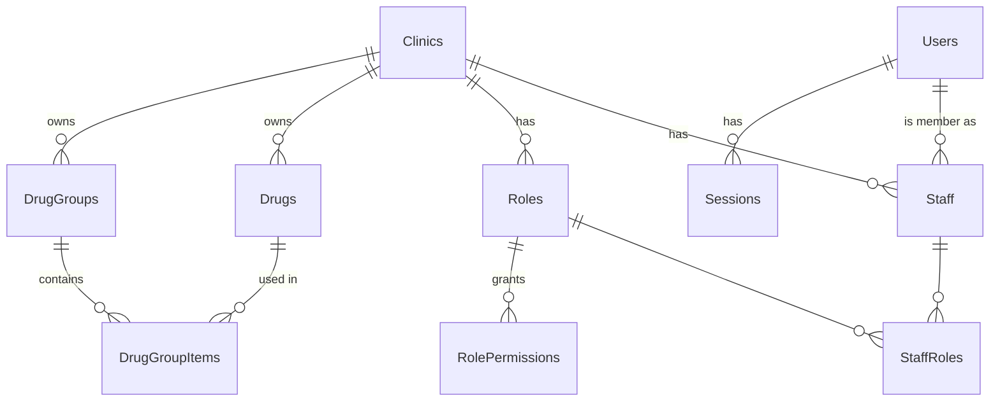
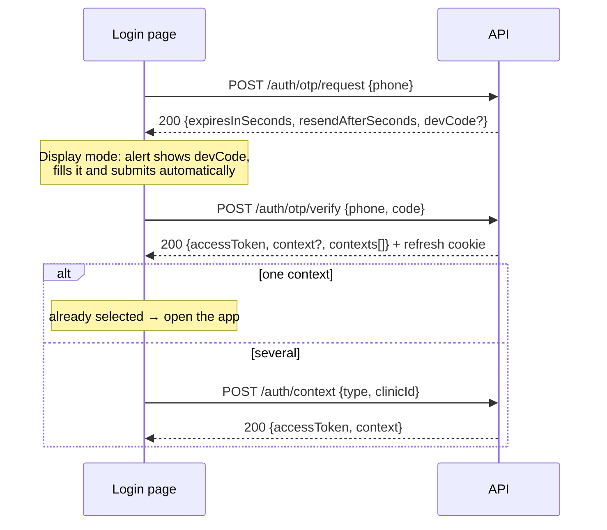

# High-level design: multi-clinic platform (MVP)

Status: **agreed design; Phase 1 (Foundations), Phase 2 (Identity) and Phase 3 (Access) implemented**
([clinic scoping](../features/clinic-scoping/tech.md), [login](../features/auth/tech.md),
[access](../features/access/tech.md)).
Decided in discussion on 2026-10-11.
When each phase is built it gets its own `docs/features/<feature>/` (tech + business) and the
overviews are updated; this file stays the big picture.

The MVP is the base of the full product, **not a throwaway**: everything here is built so later
features (patients, forms, portal, audit) are additions, not rewrites. See [Future](#11-future-not-in-the-mvp).

---

## 1. Requirements

### 1.1 Functional (MVP)

| ID | Requirement |
|---|---|
| FR-1 | The platform hosts **many clinics**. Each clinic has its own drugs, groups, staff and roles; a clinic never sees another clinic's data. |
| FR-2 | **Login is phone number + one-time code (OTP)** for everyone. No passwords. |
| FR-3 | In the MVP the OTP is **displayed** (alert on the login page, code auto-filled and submitted; also printed to the server log). Sending by SMS/WhatsApp comes later as a config switch. |
| FR-4 | A user (phone) can be staff in **one or more clinics**. With several, they pick a clinic after login and can switch later. One clinic → entered automatically. |
| FR-5 | **Roles belong to one clinic** (no global roles). A staff member can have **several roles**; their permissions are the union. |
| FR-6 | **Permissions** are fixed in code, one per action (`drugs.create`, `drugs.delete`, …). Roles are sets of permissions. Every API action checks a permission. |
| FR-7 | Each clinic has a locked **Owner** role with every permission (cannot be edited or deleted; a clinic always keeps at least one Owner). |
| FR-8 | A **super admin** (platform level, above all clinics), identified by phone numbers in config, logs in with the same OTP flow. |
| FR-9 | The super admin **creates clinics** (name + owner phone and name), renames, suspends and re-activates them. A suspended clinic cannot be used. |
| FR-10 | The super admin manages **any clinic's roles** (create, rename, set permissions, delete) and **staff** (add by phone, name, roles, deactivate, remove). |
| FR-11 | A new clinic is **provisioned** in one step: default roles, the owner, and a copy of the default drugs and groups. |
| FR-12 | Default drugs and groups live in a hidden **template clinic** that the super admin edits with the normal drugs/groups screens. Later template edits don't change existing clinics. |
| FR-13 | Drugs, groups and the prescription builder work as today, **inside the selected clinic**, gated by permissions. |
| FR-14 | The UI stays English + Arabic (RTL), including login and admin screens. |

### 1.2 Non-functional

| ID | Requirement |
|---|---|
| NFR-1 | **Isolation by default:** clinic scoping is automatic (EF query filter), not something each endpoint remembers. |
| NFR-2 | Permission or role changes apply within a minute, without logging in again. |
| NFR-3 | OTP brute force is limited (attempts per code, codes per phone per hour, requests per IP). |
| NFR-4 | Display OTP mode is **opt-in by config** (startup warning outside Development); hard-blocked again in Production once an SMS sender exists. |
| NFR-5 | All times stored in UTC (`timestamptz`). Every table has `CreatedAt`/`UpdatedAt`. |
| NFR-6 | One deployable (API + SPA), one PostgreSQL database. Production requires HTTPS. |
| NFR-7 | No automated tests in the MVP: each phase is verified manually (API calls + browser). Integration tests (isolation, permissions, auth; real PostgreSQL) come after the MVP. |

### 1.3 Out of the MVP (designed for, not built)

Patients, dynamic registration forms, patient portal, audit log, super admin entering a normal
clinic ("support access"), SMS/WhatsApp provider, clinic self sign-up, owners managing their own
staff/roles, changing a user's phone, deleting a clinic, clinic chains (organizations).

---

## 2. Glossary

| Term | Meaning |
|---|---|
| **Clinic** | The unit of data ownership. Code uses "clinic" everywhere (never "tenant"). |
| **Template clinic** | A hidden clinic (`IsTemplate`) holding the default drugs/groups copied to new clinics. |
| **User** | A phone number that can log in. Holds no personal data; names live on `Staff`. |
| **Staff** | A user's membership in one clinic (name, active flag, roles). |
| **Role / Permission** | A clinic's named set of permissions / a code constant like `drugs.create`. |
| **Super admin** | A user whose phone is listed in config; acts on the platform, not inside a clinic. |
| **Context** | What a session is currently acting as: a clinic (as staff) or the platform (as super admin). |
| **Session** | A login on one device: a refresh token + the current context. |

---

## 3. Architecture

**Modular monolith:** one ASP.NET Core API, one PostgreSQL database, one React SPA, served from one
origin in production. Modules are folders with a clear owner of each table; a module uses another
module through its services, never by writing its tables.


| Module | Owns tables | Responsibility |
|---|---|---|
| **Identity** | `Users`, `OtpCodes`, `Sessions` | OTP, sessions, tokens, contexts, `/me`, super-admin flag |
| **Access** | `Staff`, `Roles`, `RolePermissions`, `StaffRoles` | Memberships, roles, permission catalog and checks |
| **Platform** | `Clinics` | Clinic lifecycle, provisioning, template clinic, admin endpoints |
| **Catalog** | `Drugs`, `DrugGroups`, `DrugGroupItems` | Existing drugs and groups, now clinic-scoped |
| **Prescription** | none (browser) | Existing builder, unchanged except storage per clinic |

### 3.1 Backend layout

```
Drags.Api/
  Features/
    Identity/      AuthController, MeController, OtpService, SessionService, TokenService, PhoneNormalizer
    Access/        MembershipService (built in phase 2), PermissionService, Permissions.cs, DefaultRoles.cs, HasPermissionAttribute + handler
    Platform/      Admin*Controllers, ClinicProvisioningService, Seeders/ (IClinicSeeder implementations)
    Drugs/, DrugGroups/   (existing; become the Catalog module)
  Shared/          IClinicContext, ICurrentUser, IClinicOwned, IHasTimestamps, ErrorCodes, PagedResult
  Database/        AppDbContext (query filters, timestamps interceptor)
```

The current `Features/<Feature>` convention stays; a module may span several feature folders.

---

## 4. Cross-cutting design

### 4.1 Clinic scoping

- `IClinicOwned { int ClinicId }` on every clinic-owned entity (`Drugs`, `DrugGroups`,
  `DrugGroupItems`, `Staff`, `Roles`).
- `IClinicContext { int? ClinicId }`, scoped per request, filled by middleware from the token's
  `clinic_id` claim. Admin endpoints set it from the `{clinicId}` route value instead.
- `AppDbContext` applies `e.ClinicId == clinicContext.ClinicId` to every `IClinicOwned` type.
  No clinic in context → the filter matches nothing (fail closed).
- On insert, `ClinicId` is filled from the context automatically (interceptor). Saving a
  clinic-owned row with no clinic in context throws.
- Only Platform code (provisioning, admin lists across clinics) may call `IgnoreQueryFilters()`.
- Use `FirstOrDefaultAsync` with a `Where`, not `FindAsync`, so lookups always go through the filter.
- Clinic routes **never** take a `clinicId`; the clinic comes only from the token.
- Side effect we rely on: a group can only reference drugs of its own clinic, because another
  clinic's drug is invisible and returns `drugNotFound`.

### 4.2 Current user and permissions

- `ICurrentUser { UserId, SessionId, ClinicId?, StaffId?, IsPlatform, IsSuperAdmin }` from claims.
- `[HasPermission(Permissions.DrugsUpdate)]` on actions → policy handler asks
  `PermissionService.GetPermissions(staffId)`.
- Permissions are **not** in the token. `PermissionService` loads the staff's roles + clinic status
  and caches it in memory for 60 s; any change to that clinic's roles/staff clears the cache. *(Built in phase 3 with HybridCache: 10 min expiry, 30 s local, invalidated by tag; see [access](../features/access/tech.md).)*
- Owner role → all permissions. Inactive staff or suspended clinic → 403 (`noAccess` /
  `clinicSuspended`).
- Admin endpoints: `[Authorize(Policy = "SuperAdmin")]` requires a platform-context token.

### 4.3 Timestamps

`IHasTimestamps { CreatedAt, UpdatedAt }` filled by a `SaveChanges` interceptor with
`DateTime.UtcNow`. `CreatedBy`/audit trail is deferred (Audit module later).

### 4.4 Errors

Unchanged convention: `ProblemDetails` with a `code`, translated by the SPA (`errors.<code>`).
401 = no/expired access token (the SPA refreshes and retries once). 403 = authenticated but not
allowed (`forbidden`, `noAccess`, `clinicSuspended`).

### 4.5 Phone numbers

Normalized to E.164 (`+201001234567`) with `libphonenumber-csharp`, default region `EG`.
Invalid → `invalidPhone`. The SPA sends what the user typed; the server normalizes.

---

## 5. Data model (PostgreSQL)

All `Id`s are `integer` identity unless noted. All tables have `CreatedAt`/`UpdatedAt timestamptz NOT NULL`
(omitted below). Names in PascalCase as EF creates them.



### 5.1 Identity

**Users**

| Column | Type | Rules |
|---|---|---|
| Id | int | PK |
| Phone | varchar(20) | E.164, **unique** |
| IsSuperAdmin | boolean | set only by the startup seeder from config |
| LastLoginAt | timestamptz null | |

**OtpCodes**

| Column | Type | Rules |
|---|---|---|
| Id | int | PK |
| Phone | varchar(20) | indexed `(Phone, CreatedAt)` |
| CodeHash | varchar(100) | HMAC-SHA256 of the code, never the code |
| ExpiresAt | timestamptz | now + 5 min |
| Attempts | int | max 5, then the code is dead |
| ConsumedAt | timestamptz null | single use |

Codes exist for any valid phone (even unknown ones) so responses don't reveal who has an account.
Old rows are deleted by a cleanup on each request (older than 1 day).

**Sessions**

| Column | Type | Rules |
|---|---|---|
| Id | uuid | PK, `sid` claim |
| UserId | int | FK → Users, cascade |
| RefreshTokenHash | varchar(100) | **unique**; rotated on every refresh |
| ContextType | varchar(20) null | `clinic` / `platform` / null (not chosen yet) |
| ClinicId | int null | FK → Clinics; set when `ContextType = clinic` |
| ExpiresAt | timestamptz | sliding: 30 days (12 h for every super-admin session, as built in phase 2) |
| LastUsedAt | timestamptz | |
| RevokedAt | timestamptz null | logout, staff removed, clinic suspended |

### 5.2 Access

**Staff** (`IClinicOwned`)

| Column | Type | Rules |
|---|---|---|
| Id | int | PK |
| ClinicId | int | FK → Clinics, restrict |
| UserId | int | FK → Users, restrict |
| FullName | varchar(256) | required |
| IsActive | boolean | inactive = cannot enter the clinic |
| | | **unique `(ClinicId, UserId)`** |

**Roles** (`IClinicOwned`)

| Column | Type | Rules |
|---|---|---|
| Id | int | PK |
| ClinicId | int | FK → Clinics, cascade |
| Name | varchar(100) | required, **unique `(ClinicId, Name)`** |
| IsOwner | boolean | locked, all permissions; **one per clinic** (partial unique index `(ClinicId) WHERE IsOwner`) |

**RolePermissions**: `RoleId` (FK, cascade) + `Permission varchar(100)`, PK `(RoleId, Permission)`.
Values must be in `Permissions.All` (`unknownPermission`). Owner roles have no rows (implicit all).

**StaffRoles**: `StaffId` (FK, cascade) + `RoleId` (FK, cascade), PK `(StaffId, RoleId)`.
The role must belong to the staff's clinic (checked in `AccessService`; the filter hides other clinics' roles anyway). *(Built in phase 3: `StaffRoles` also has `ClinicId`, with composite FKs to `Staff(Id, ClinicId)` and `Roles(Id, ClinicId)`, so the database enforces it.)*

### 5.3 Platform

**Clinics**

| Column | Type | Rules |
|---|---|---|
| Id | int | PK |
| Name | varchar(256) | required |
| Status | varchar(20) | `active` / `suspended` |
| IsTemplate | boolean | **one template** (partial unique index `WHERE IsTemplate`); excluded from admin lists and staff contexts |

### 5.4 Catalog (changes to existing tables)

| Table | Change |
|---|---|
| Drugs | + `ClinicId` (FK, restrict), index `(ClinicId, Name)`, timestamps |
| DrugGroups | + `ClinicId` (FK, restrict), index `(ClinicId, Name)`, timestamps |
| DrugGroupItems | + `ClinicId` (same as its group; makes the filter uniform), timestamps; composite FKs `(DrugGroupId, ClinicId)` → `DrugGroups(Id, ClinicId)` and `(DrugId, ClinicId)` → `Drugs(Id, ClinicId)` so the DB enforces one clinic per line |

Everything else (owned `Dosing`, cascades, one drug per group per eye) is unchanged.

### 5.5 Migrations

Nothing is in production, so the PostgreSQL `Initial` is regenerated with this schema and dev
databases are reset (`docker compose down -v`). After the first deployment, the data-preserving
rules in the tech overview apply.

---

## 6. Permissions and default roles

`Features/Access/Permissions.cs` (labels in `en.ts`/`ar.ts` under `permissions.*`):

One permission per action, named `resource.action`:

| Permission | Allows |
|---|---|
| `drugs.list` | Drugs list and search (also the drug picker) |
| `drugs.details` | Open one drug, see which groups use it |
| `drugs.create` | Add a drug |
| `drugs.update` | Edit a drug |
| `drugs.delete` | Delete a drug |
| `groups.list` | Groups list and search (also the group picker) |
| `groups.details` | Open one group |
| `groups.create` | Add a group |
| `groups.update` | Edit a group (name, drugs, order, dosing) |
| `groups.delete` | Delete a group |
| `prescriptions.create` | Use the prescription page (also needs `drugs.list` and/or `groups.list` to pick) |

New modules add their own (`staff.*`, `roles.*`, `patients.*`, …) when they are built.
The admin role editor shows them grouped by resource, and warns when a permission is picked
without the ones it needs (e.g. `drugs.update` without `drugs.details`).

Default roles seeded into every new clinic (`DefaultRoles.cs`):

| Role | Permissions |
|---|---|
| Owner | all (`IsOwner`) |
| Doctor | all of the above |
| Assistant | all except `drugs.delete`, `groups.delete` |

---

## 7. Flows

### 7.1 Login



- Verify succeeds only if the phone has at least one active staff membership in an active,
  non-template clinic, or is a super admin. Otherwise `noAccess` (403) and no session.
- Contexts: each active staff clinic (`type: clinic`), plus `platform` and the template clinic
  for super admins.
- The access token (15 min, JWT, HS256) is kept **in memory** by the SPA. The refresh token is an
  `HttpOnly; Secure; SameSite=Strict; Path=/api/v1/auth` cookie. On page load the SPA calls
  `/auth/refresh` to get a new access token.
- Token claims: `sub` (user id), `sid` (session), `ctx` (`clinic`/`platform`), `clinic_id`,
  `staff_id`. Platform-context tokens also carry `super_admin`.

### 7.2 Switching clinic

User menu → "Switch clinic" → `POST /auth/context` → new access token; the SPA clears its query
cache and reloads the clinic app. The session's stored context changes, so refresh keeps it.

### 7.3 Clinic provisioning

`POST /admin/clinics` → `ClinicProvisioningService.CreateAsync(name, ownerPhone, ownerName)`, one
transaction, ordered `IClinicSeeder` steps:

1. `ClinicSeeder`: insert the clinic (`active`).
2. `RolesSeeder`: insert the default roles + permissions (`DefaultRoles`).
3. `OwnerSeeder`: find or create the `User` by phone; insert `Staff` with the Owner role.
4. `CatalogSeeder`: copy the template clinic's drugs, then its groups + items with drug ids remapped.

Any failure rolls back everything. New modules add a seeder (e.g. the default registration form).

### 7.4 Startup seeding

Every start (idempotent): ensure the template clinic exists; ensure every phone in
`Platform:SuperAdminPhones` has a `User` with `IsSuperAdmin = true` (and no other user has it).
Development only, on an empty DB: provision a "Demo clinic" owned by `Platform:DevOwnerPhone`.
Built so far (phases 1–2): the template is ensured; super admins are seeded from config (others lose
the flag and their sessions); on an empty dev DB "Demo clinic" (10,000 sample drugs) and "Second
demo clinic" (a few drugs + one group, for isolation checks) are created directly, in one
transaction, with the `DevOwnerPhone` user as staff "Dev Owner" in both (no roles yet). Owner roles
and provisioning come with phases 3–4.

### 7.5 Editing the template

The super admin picks the "Template clinic" context, then uses the normal drugs/groups screens.
The token has `clinic_id` = template and every permission. This is the only clinic a super
admin can enter in the MVP (support access to real clinics comes with the audit log).

### 7.6 Suspending a clinic / removing staff

Suspend → `Status = suspended`, revoke that clinic's sessions, clear the permission cache. Next
request from its staff → 401, then refresh fails → login → `noAccess`. Deactivating or removing
a staff member does the same for that staff's sessions in that clinic. The last active Owner of
a clinic cannot be removed, deactivated or lose the Owner role (`lastOwner`).

---

## 8. API contracts (`/api/v1`)

Shared shapes: `PagedResult<T> = { items, totalCount, page, pageSize }`; errors are ProblemDetails
with `code`.

### 8.1 Auth (anonymous unless noted)

| Method | Route | Request | Response |
|---|---|---|---|
| POST | `/auth/otp/request` | `{ phone }` | `200 { expiresInSeconds, resendAfterSeconds, devCode? }`. Errors: `invalidPhone`, `tooManyRequests` (429) |
| POST | `/auth/otp/verify` | `{ phone, code }` | `200 AuthResult` + refresh cookie. Errors: `invalidCode`, `codeExpired`, `tooManyAttempts`, `noAccess` (403) |
| POST | `/auth/refresh` | (cookie) | `200 AuthResult`, rotates the cookie. 401 if invalid |
| POST | `/auth/context` | `{ type: "clinic" \| "platform", clinicId? }` (authenticated) | `200 AuthResult`. Errors: `noAccess`, `clinicSuspended` |
| GET | `/auth/contexts` | (authenticated) | `200 Context[]` |
| POST | `/auth/logout` | (cookie) | `204`, session revoked, cookie cleared |
| GET | `/me` | (authenticated) | `200 Me` |

```ts
type AuthResult = {
  accessToken: string; expiresAt: string;      // ISO UTC
  context: Context | null;                     // null → the user must pick one
  contexts: Context[];
};
type Context =
  | { type: "clinic"; clinicId: number; clinicName: string; isTemplate: boolean; roles: string[] }
  | { type: "platform" };
type Me = {
  user: { id: number; phone: string; isSuperAdmin: boolean };
  context: Context | null;
  staff: { id: number; fullName: string } | null;
  permissions: string[];                       // expanded keys (phase 3: every key for Owner / template access, not "*")
};
```

**Built in phase 2 (deviations from the table above)** — see [login tech](../features/auth/tech.md):
- `GET /auth/otp/mode` (anonymous) → `{ mode }`, so the login page shows the display-mode banner up front.
- `/auth/refresh` and `/auth/context` return 409 when a parallel call rotated the cookie < 30 s ago
  (cookie kept); `/auth/context` also requires the session's refresh cookie (401 otherwise).
- `/auth/otp/verify` also returns `invalidPhone`.
- Every super-admin session lasts 12 h (sliding). Display mode is allowed in **any** environment by
  config (startup warning outside Development), replacing NFR-4 until an SMS sender exists, so a demo
  or staging server can run; `Otp:Mode` defaults to `Sms`, which is refused until a sender exists.
- Sessions are not revoked on suspension or staff deactivation yet: access is re-checked at refresh
  and switch, and open access tokens stay valid ≤ 15 min (7.6's "next request → 401" is not met yet).

### 8.2 Catalog (clinic context; existing contracts unchanged)

| Endpoint | Permission |
|---|---|
| `GET /drugs` | `drugs.list` |
| `GET /drugs/{id}`, `GET /drugs/{id}/groups` | `drugs.details` |
| `POST /drugs` | `drugs.create` |
| `PUT /drugs/{id}` | `drugs.update` |
| `DELETE /drugs/{id}` | `drugs.delete` |
| `GET /drug-groups` | `groups.list` |
| `GET /drug-groups/{id}` | `groups.details` |
| `POST /drug-groups` | `groups.create` |
| `PUT /drug-groups/{id}` | `groups.update` |
| `DELETE /drug-groups/{id}` | `groups.delete` |

An id from another clinic returns 404, exactly like a missing id.

### 8.3 Admin (platform context, super admin)

| Method | Route | Request | Response / errors |
|---|---|---|---|
| GET | `/admin/clinics?search&status&page&pageSize` | | `PagedResult<ClinicSummary>` |
| GET | `/admin/clinics/{id}` | | `Clinic` |
| POST | `/admin/clinics` | `{ name, owner: { phone, fullName } }` | `201 Clinic`. `nameRequired`, `invalidPhone` |
| PUT | `/admin/clinics/{id}` | `{ name }` | `Clinic` |
| POST | `/admin/clinics/{id}/suspend` · `/activate` | | `204` |
| GET | `/admin/permissions` | | `string[]` (labels are translated in the SPA) |
| GET | `/admin/clinics/{id}/roles` | | `Role[]` |
| POST | `/admin/clinics/{id}/roles` | `{ name, permissions[] }` | `201 Role`. `roleNameTaken`, `unknownPermission` |
| PUT | `/admin/clinics/{id}/roles/{roleId}` | `{ name, permissions[] }` | `Role`. `roleLocked` (Owner) |
| DELETE | `/admin/clinics/{id}/roles/{roleId}` | | `204`. `roleLocked`, `roleInUse` |
| GET | `/admin/clinics/{id}/staff?search&page&pageSize` | | `PagedResult<StaffMember>` |
| POST | `/admin/clinics/{id}/staff` | `{ phone, fullName, roleIds[] }` | `201 StaffMember`. `invalidPhone`, `staffExists`, `rolesRequired` |
| PUT | `/admin/clinics/{id}/staff/{staffId}` | `{ fullName, isActive, roleIds[] }` | `StaffMember`. `lastOwner`, `rolesRequired` |
| DELETE | `/admin/clinics/{id}/staff/{staffId}` | | `204`. `lastOwner` |

The template clinic is not reachable here (404); it is edited through its context (7.5).

```ts
type ClinicSummary = { id: number; name: string; status: "active" | "suspended"; staffCount: number; createdAt: string };
type Clinic = ClinicSummary & { ownerNames: string[] };
type Role = { id: number; name: string; isOwner: boolean; permissions: string[]; staffCount: number };
type StaffMember = { id: number; userId: number; phone: string; fullName: string; isActive: boolean;
                     roles: { id: number; name: string }[] };
```

### 8.4 New error codes

`invalidPhone`, `invalidCode`, `codeExpired`, `tooManyAttempts`, `tooManyRequests`, `noAccess`,
`clinicSuspended`, `forbidden`, `roleNameTaken`, `unknownPermission`, `roleLocked`, `roleInUse`,
`rolesRequired`, `staffExists`, `lastOwner`. Each goes in `ErrorCodes.cs` and `errors.*` in both locales.

---

## 9. Frontend

| Piece | Design |
|---|---|
| Routes | `/login`, `/select-clinic`, clinic app (`/`, `/drugs`, `/groups`…), `/admin/*` (own `AdminLayout`, lazy) |
| `features/auth` | `LoginPage` (phone → code; display mode: alert + auto-fill + auto-submit, visible "OTP display mode" banner), `SelectClinicPage`, `AuthProvider` (access token in memory, `me`, `switchContext`, `logout`), `RequireAuth`, `RequirePermission` |
| API client | Interceptor adds `Authorization: Bearer`; on 401 calls `/auth/refresh` once (shared promise) and retries, else → `/login` |
| Permissions | `useCan(permission)` + `<Can permission>`; `NAV_ITEMS` get a `permission`; pages wrapped in `RequirePermission`. The API always enforces. |
| Layout | App bar shows the clinic name and a user menu (switch clinic, logout); a banner when editing the template |
| `features/admin` | `ClinicsPage` (list, create, suspend), `ClinicPage` with tabs **Staff** and **Roles** (permission checklist) |
| Prescription | `localStorage` key becomes `prescription.lines.<clinicId>` so clinics never mix |
| Dev | Vite proxies `/api` → `http://localhost:5000` so cookies are same-origin; `VITE_API_BASE_URL` becomes `/api/v1` |
| i18n | All new strings in `en.ts` and `ar.ts` (`auth.*`, `admin.*`, `permissions.*`, `errors.*`) |

---

## 10. Configuration

```jsonc
{
  "Auth": {
    "Jwt": { "Issuer": "drags", "Audience": "drags", "SigningKey": "<secret ≥ 32 bytes, env var in prod>" },
    "AccessTokenMinutes": 15,
    "RefreshTokenDays": 30,
    "PlatformSessionHours": 12
  },
  "Otp": {
    "Mode": "Display",          // Display | Sms. Built: Display allowed anywhere by config (warning outside Development); default Sms, refused until a sender exists
    "Length": 6, "ExpiryMinutes": 5, "MaxAttempts": 5,
    "ResendSeconds": 60, "MaxPerPhonePerHour": 5,
    "HashKey": "<secret>"
  },
  "Platform": {
    "DefaultRegion": "EG",
    "SuperAdminPhones": ["+20…"],
    "DevOwnerPhone": "+20…"      // Development seed only
  }
}
```

Rate limiting (ASP.NET Core built-in): `/auth/otp/*` 10 requests/min per IP. Secrets come from
environment variables in production, never `appsettings.json`.

---

## 11. Future (not in the MVP)

How the MVP leaves room, so these are additions:

| Feature | Fits by |
|---|---|
| **Patients** | `Patients(Id, UserId, ClinicId, FullName, FileNo, FormVersionId, FormData jsonb)`, unique `(UserId, ClinicId)`; the phone is the only shared data. Clinic data references `Patients.Id`, never `UserId`. Assistant registers by phone (find/create `User`). |
| **Patient portal** | A new context type `patient`; `GET /me/clinics`. Same OTP login. |
| **Dynamic forms** | `FormDefinitions` (global, built by the super admin, versioned, stores `Fields` + generated JSON Schema), `ClinicForms` assignment, RJSF renderer from the POC, server validation with JsonSchema.Net; a provisioning seeder assigns the default form. |
| **OTP by SMS/WhatsApp** | `IOtpSender` implementation + `Otp:Mode = Sms`. |
| **Audit + support access** | `AuditLogs`; super admin may then pick any clinic as context (`impersonating`, banner). |
| **Owners manage staff/roles** | Permissions `staff.manage`/`roles.manage` + clinic-side screens reusing the admin services. |
| **Custom clinic chains** | `Organizations` above `Clinics`; `ClinicId` stays the isolation key. |

---

## 12. Delivery phases

| # | Phase | Done when |
|---|---|---|
| 1 | **Foundations**: `IClinicOwned`, `IClinicContext`, query filter, timestamps | ✅ **Done** (2026-10-11): verified manually with two seeded clinics, neither sees the other's data |
| 2 | **Identity**: users, OTP (display), sessions, tokens, contexts, `/me`; login + select-clinic pages | ✅ **Done** (2026-10-11): login, refresh, switch and logout verified in the browser ([login](../features/auth/tech.md)). Also built here: a minimal `Staff` table (no roles) with `Access/MembershipService`. The display-mode guard was built, then relaxed on request: Display is allowed in any environment by config (startup warning outside Development) so demos/staging can run before an SMS provider. Super-admin sessions always use the 12 h lifetime. `/me` permissions are `["*"]` until phase 3 |
| 3 | **Access**: staff, roles, permissions, `[HasPermission]`, `<Can>`. The cached per-request permission check should also verify the staff member (and clinic) is still active, closing the ≤ 15 min gap after removal/suspension | ✅ **Done** (2026-10-12): catalog endpoints, nav, pages and buttons are permission-gated; verified with Owner, Assistant and a read-only Viewer ([access](../features/access/tech.md)). Built with: HybridCache (10 min expiry, 30 s local) instead of a 60 s in-memory cache, invalidated by tag; `StaffRoles` with composite FKs including `ClinicId` (no `AccessService` check needed); migration `AddRoles` added on top of `Initial`; `GET /permissions` returns the catalog for any token (phase 4's role editor) |
| 3.5 | **Architecture refactor** (pure refactor, no behavior change): 4 layers, MediatR use cases, `Result`/`Error`, one ProblemDetails shape ([architecture](architecture.md)) | Same endpoints and responses verified manually; Phase 4 is written in the new structure |
| 4 | **Platform**: clinic admin, provisioning, template content, super-admin/owner seeding, admin area (the `Clinics` table, template row and dev seed exist since phase 1; the template is still **empty**: phase 4 must fill it, e.g. dev seed puts the sample drugs/groups in the template, before provisioning copies from it) | Super admin creates a clinic and its owner logs in to a copied catalog |
| 5 | **Hardening**: rate limits, display-mode guard for real production once an SMS sender exists (relaxed to a config choice in phase 2), docs (features + overviews, both languages) | Checks green; RTL verified |

## 13. Open questions

- OTP provider for production (SMS gateway vs. WhatsApp Cloud API).
- Hosting (public HTTPS + managed PostgreSQL + backups).
